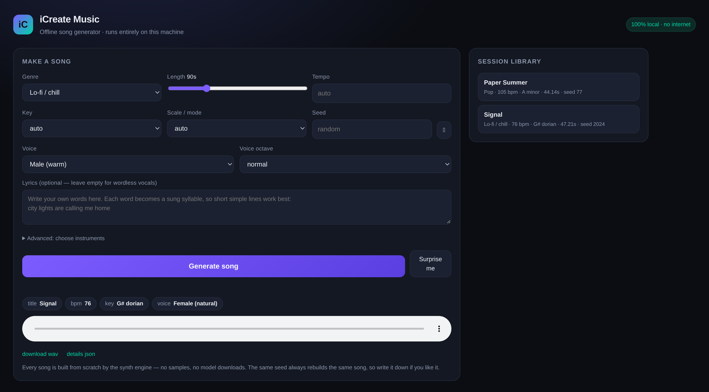
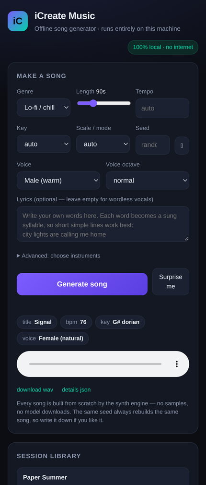

# iCreate Music

A local, offline song generator. Pick a style, press a button, get a finished
stereo track — with drums, bass, chords, a melody and a singing voice — rendered
on your own machine. No account, no API key, no internet, no downloads.

```
python -m icreate_music
```

That opens the app at `http://127.0.0.1:7860`. Press **Generate song**.



<p align="center"></p>

---

## Download the Android app

[**icreate-music.apk**](https://github.com/technicalnihilist-lgtm/icreateappmusic/releases/latest/download/icreate-music.apk)
— 49.5 MB, Android 8.0+, rebuilt automatically on every push to `main`.

It bundles CPython 3.11 + numpy + this engine inside the APK, so the phone
renders songs on-device with no server and no network. Sideload it (enable
"install unknown apps" for your file manager), tap Install, open it. First
launch takes 10–30 s while Python unpacks; after that it is quick. It is
debug-signed, which is fine for personal use but not for the Play Store.

## What this actually is (read this first)

There are two very different things people mean by "AI song generator", and it
matters which one you have:

| | What it is | This app |
|---|---|---|
| **A. Algorithmic composition + synthesis** | Code writes the music theory (key, chords, melody, arrangement) and a synth engine renders every sound from scratch | **Yes — this is what you have** |
| **B. Neural network generation** | A trained model (MusicGen, Stable Audio…) predicts audio from learned weights; needs a multi-GB model file | No — see [Going further](#going-further-if-you-want-a-neural-model) |

So: **unlimited songs, instantly, fully offline, yes.** "AI" here means the
composer is an algorithm — motif generation, chord voicing, arrangement and
voice synthesis are all computed, not sampled from a library. Nothing is
downloaded and no samples are shipped; every kick, string and vowel is
synthesised from maths at render time.

What it is *not*: it will not clone a specific real person's voice out of the
box, and it will not produce the "photorealistic" audio a large diffusion model
does. Those need model weights, which are covered at the end.

---

## Install

Only requirement: **Python 3.8+ and numpy**.

```bash
cd icreate_music
pip install numpy          # the only hard dependency
bash run.sh                # macOS / Linux   (or: python -m icreate_music)
run.bat                    # Windows
```

Then open <http://127.0.0.1:7860>. Stop it with `Ctrl+C`.

## Make a song from the terminal

```bash
# one song, 90 seconds of lo-fi
python -m icreate_music cli --genre lofi --seconds 90

# a named, reproducible song with your own lyrics
python -m icreate_music cli --genre pop --key C --scale minor \
    --bpm 110 --voice female --lyrics "hold the light a little longer" \
    --seed 4242 --out my_song.wav

# an entire album: 20 different songs in one go
python -m icreate_music cli --count 20 --genre edm --seconds 120 --out album/

# instrumental, with per-track stems and an mp3
python -m icreate_music cli --genre cinematic --instrumental --stems --mp3

# what can I choose from?
python -m icreate_music cli --list
```

Every song also writes a `.json` beside the `.wav` with its title, tempo, key,
chord progression, section map, instruments and seed. Same seed + same
settings = the same song, always.

## Genres

Lo-fi / chill · Pop · EDM / dance · Synthwave · Rock · Hip-hop / trap ·
Cinematic / score · Ambient · Folk / acoustic · Jazz

Each genre carries its own tempo range, scales, chord progressions, drum
patterns, instrumentation, swing feel, reverb size and mix balance — that is
why a jazz track and an EDM track sound like different worlds rather than the
same thing at two speeds.

## Voices

Nine voices, all synthesised (a glottal source shaped by vowel formants, with
vibrato, jitter and breath):

`male` · `male_deep` · `female` · `female_high` · `child` · `choir` ·
`breathy` · `robot` · `whisper`

* **Wordless vocals:** leave the lyrics box empty and the singer vocalises.
* **Your own lyrics:** type words and they are sung. The singer splits your text
  into syllables, sings each syllable on one melody note, and picks the vowel
  from the spelling. Simple, vowel-rich lines work best —
  `city lights are calling me home` sings well; dense consonant clusters less so.
* **Register:** the *voice octave* control moves the whole vocal line up or down
  an octave.

Honest limits: this is formant synthesis, so it sounds like a synthetic singer
(think early vocaloid / vocoder-adjacent), not a recorded human. Intelligibility
is approximate — it reads as a voice singing words rather than a studio vocal.

## Train a voice from a song

Put in any song — an artist's track, your own recording — and the app will
split it, study the singer, and add that voice to the list you can generate
with. All local.

```bash
# from the terminal
python -m icreate_music train song.mp3 --name "Artist One"
python -m icreate_music cli --list-voices
python -m icreate_music cli --genre pop --voice artist-one --lyrics "new words here"
```

In the app: the **Train a voice from a song** card, top right — pick a file,
name it, press *Separate & train*. You get a preview of the voice, the isolated
stems, and the profile appears in the Voice dropdown.

What actually happens:

1. **Separation** (`separate.py`) — vocals vs music. Lead vocals sit dead centre
   in a mix, so a mid/side mask plus a 120 Hz–9 kHz band isolates them. Measured
   against a known vocal stem this scores ~2–2.7 dB SI-SDR: enough to profile a
   voice, not enough for a karaoke track. Install Demucs (`pip install demucs`)
   and the app uses it automatically for studio-grade stems.
2. **Analysis** (`train_voice.py`) — autocorrelation pitch tracking, vibrato rate,
   vocal-tract size from cepstrally-smoothed formants, breathiness from
   harmonic-to-noise ratio, brightness from pitch-normalised spectral centroid.
3. **Profile** — saved as JSON in `songs/voices/`, then registered with the
   synthesiser so `--voice <slug>` sings with it, in that singer's register.

**How close is it?** Measured against a voice whose true settings were known:

| feature | recovered | truth | error |
|---|---|---|---|
| vocal-tract scale | 1.13 | 1.16 | −3% |
| register (median f0) | 401 Hz | 400 Hz | +0.3% |
| vibrato rate | 6.9 Hz | 5.6 Hz | +23% |
| brightness | 1.19 | 1.05 | +13% |
| breathiness | 0.09 | 0.12 | −25% |

From a *separated* stem (not a clean one) expect more drift — roughly −14% on
vocal-tract size and an over-estimate of breathiness, because instrumental bleed
lowers the harmonic-to-noise ratio. Vibrato *depth* is not reliably separable
from note-level pitch movement, so it stays at a natural default rather than a
made-up value.

Be clear-eyed about the ceiling: this matches the **timbre family and the
mannerisms**, not the identity. It is not neural voice cloning. RVC or So-VITS
reproduce a specific human voice far more convincingly, need GBs of weights and
a GPU, and — this part matters — need the singer's consent. Cloning a real
artist's voice without permission is illegal in many jurisdictions, including
under India's IT Rules and personality rights, and it is not what this feature
is for. Use it on your own voice, on voices you have rights to, or as a
stylistic starting point.

## Instruments

`piano` · `epiano` · `guitar` · `pluck` · `pad` · `strings` · `brass` · `lead` ·
`organ` · `bass` · `sub` · `bell` · `marimba` · `flute`

Assign any of them to the keys, pad, bass, arp or lead slot (CLI:
`--keys-inst organ --bass-inst sub --lead-inst flute`, or the *Advanced* panel
in the app). Drums are built per genre from kick / snare / rim / hat / open hat /
clap / toms / crash / shaker.

## How a song is built

1. **Key and tempo** — chosen from the genre's range, or fixed by you.
2. **Harmony** — a roman-numeral progression from the genre's pool, voiced into
   triads across two octaves.
3. **Melody** — a two-bar motif, repeated and varied, walking through the scale
   with mean reversion so phrases arch instead of drifting, snapping to chord
   tones on strong beats.
4. **Arrangement** — intro / verse / chorus / bridge / outro with an energy
   value per section that decides which instruments enter, how dense the melody
   is, and how hard the drums hit.
5. **Voices** — each instrument renders every note from oscillators, filters and
   envelopes; the singer renders the melody line against your syllables.
6. **Mix** — per-track loudness matching and panning, sidechain pump (EDM),
   convolution reverb built from a synthetic impulse, bus compression, soft
   clipping and a fade.

## The neural lab (optional, `audio-encoders-pytorch`)

`icreate_music/neural.py` uses
[audio-encoders-pytorch](https://github.com/archinetai/audio-encoders-pytorch)
and audio-data-pytorch to train a small neural **audio codec** on your own
generated library, then store songs as compact latents and rebuild them.

```bash
pip install torch torchaudio audio-encoders-pytorch audio-data-pytorch pyloudnorm
python -m icreate_music.neural check
python -m icreate_music.neural train songs/ --steps 2000 --out codec.pt
python -m icreate_music.neural compress songs/mysong.wav --codec codec.pt
python -m icreate_music.neural expand songs/mysong.icm.npz
```

**What it does not do:** it does not generate music. audio-encoders-pytorch
ships encoder/decoder *architectures* and **no pretrained weights** — it is a
library for building and training codecs, not a music model. Training one
locally is genuinely useful for compression and for producing latent tensors a
generative model could later be trained on.

**Measured on this machine** (CPU, 0.12M-param model, 300 steps on one song):
spectral correlation 0.73, waveform correlation 0.06 — it learns the spectral
envelope quickly but not waveform phase. Expect to need thousands of steps (and
ideally a GPU) before a rebuild sounds like the original. The tool reports both
numbers honestly rather than pretending.

## Going further: if you want a neural model

If what you want is a model that *predicts* audio, the practical offline route
is MusicGen — download the weights once, then it runs with no internet:

```bash
pip install torch transformers scipy accelerate
python - <<'PY'
from transformers import AutoProcessor, MusicgenForConditionalGeneration
import scipy.io.wavfile
model_id = "facebook/musicgen-small"          # ~2 GB, fetched once
proc = AutoProcessor.from_pretrained(model_id)
model = MusicgenForConditionalGeneration.from_pretrained(model_id)
inputs = proc(text=["warm lo-fi hip hop with soft piano and vinyl crackle"],
              return_tensors="pt")
audio = model.generate(**inputs, max_new_tokens=512)   # ~10 s of audio
scipy.io.wavfile.write("musicgen.wav", 32000, audio[0, 0].numpy())
PY
```

Reality check: `musicgen-small` on CPU takes minutes per 10 seconds of audio and
gives you no vocals and no lyric control. That is why this app exists — it makes
a full song with a singing voice in seconds on a laptop.

For **voice cloning** of a real person (RVC, So-VITS-SVC, XTTS), you need model
weights and a reference recording, and you should only do it with that person's
consent — cloning someone's voice without permission is illegal in many places
(including under India's IT Rules and personality rights) and is a good way to
lose a friend.

## Android app (APK)

The same engine ships as an Android app — Chaquopy bundles Python 3.11 + numpy
inside the APK, so the phone renders songs on-device with no server and no
network. See [`mobile/README.md`](mobile/README.md) for the build steps.

The quickest route is CI: the **Build APK** workflow compiles
`mobile/` on GitHub's runners and uploads `icreate-music.apk` as an artifact —
no Android Studio needed. Expect slower renders than desktop (2–4×), so keep
phone songs around 30–60 seconds.

## Troubleshooting

**`ImportError: libtorch_cpu.so: failed to map segment`** — the shell has an
address-space cap. Run `ulimit -v unlimited` before starting Python (only
affects the neural lab; the generator never needs torch).

**Rendering feels slow** — a 3-minute song takes roughly 40–60 s on a modern
laptop (about 0.3–0.5× real time). Use `--seconds 60` while experimenting, and
`--sr 22050` for quick sketches.

**No mp3, only wav** — mp3 export needs the `ffmpeg` binary on your PATH;
without it you still get wav. (`brew install ffmpeg` / `sudo apt install ffmpeg`)

**Port already in use** — `python -m icreate_music --port 7861`.

**It sounds nothing like the genre I picked** — try a different seed first
(`--seed`); each genre has a wide expressive range by design.

## Files

```
icreate_music/
├── __main__.py     entry point (web app, or `cli` subcommand)
├── cli.py          command line
├── webapp.py       local web UI (stdlib http.server, no framework)
├── song.py         composer + arranger + mixer, genre definitions
├── theory.py       scales, chords, progressions, titles
├── synth.py        oscillators, instruments, drums, effects
├── voice.py        formant singing synthesis, lyric syllabifier
├── neural.py       optional audio-encoders-pytorch codec lab
└── export.py       wav / stems / manifest writing
```

Everything you make is yours to use. The code is MIT-style: no attribution
needed, no strings attached.

---

## ⭐ Like this work? Give it a star

If you like this app and our work, please **star this repository** ⭐ and **[follow technicalnihilist-lgtm on GitHub](https://github.com/technicalnihilist-lgtm)**. If our work isn't for you, that's completely fine — the choice is yours. Thank you for stopping by!

<details>
<summary><b>🌍 Same message in 32 languages (A–Z + Indian languages)</b></summary>

- **A — Arabic** (العربية): ⭐ إذا أعجبك هذا التطبيق وعملنا، فيرجى منح المستودع نجمة ومتابعتنا. وإذا لم يعجبك عملنا، فلا مشكلة على الإطلاق — القرار قرارك. شكرًا لزيارتك!
- **B — Bengali** (বাংলা): ⭐ যদি আপনার এই অ্যাপ এবং আমাদের কাজ ভালো লাগে, তবে অনুগ্রহ করে রিপোজিটরিটিকে একটি স্টার দিন এবং আমাদের ফলো করুন। আমাদের কাজ যদি আপনার পছন্দ না হয়, তাতেও কোনো সমস্যা নেই — সিদ্ধান্ত আপনার। আমাদের পেজে আসার জন্য ধন্যবাদ!
- **C — Chinese** (中文): ⭐ 如果你喜欢这个应用和我们的作品，请给仓库点个星标并关注我们。如果我们的作品不适合你，也完全没关系——选择权在你。感谢你的到访！
- **D — Dutch** (Nederlands): ⭐ Vind je deze app en ons werk leuk? Geef de repository dan een ster en volg ons. Vind je ons werk niets, dan is dat helemaal prima — de keuze is aan jou. Bedankt voor je bezoek!
- **E — English** (English): ⭐ If you like this app and our work, please give the repository a star and follow us. If our work isn't for you, that's completely fine — the choice is yours. Thank you for stopping by!
- **F — French** (Français): ⭐ Si cette application et notre travail vous plaisent, mettez une étoile au dépôt et suivez-nous. Si notre travail n'est pas pour vous, aucun souci — c'est votre choix. Merci de votre visite !
- **G — German** (Deutsch): ⭐ Wenn dir diese App und unsere Arbeit gefallen, gib dem Repository einen Stern und folge uns. Wenn unsere Arbeit nichts für dich ist, ist das völlig in Ordnung — die Wahl liegt bei dir. Danke fürs Vorbeischauen!
- **H — Hindi** (हिन्दी): ⭐ अगर आपको यह ऐप और हमारा काम पसंद है, तो कृपया रिपॉजिटरी को स्टार दें और हमें फॉलो करें। अगर हमारा काम आपके लिए नहीं है, तो भी कोई बात नहीं — यह पूरी तरह आपकी मर्ज़ी है। यहाँ आने के लिए आपका धन्यवाद!
- **I — Indonesian** (Bahasa Indonesia): ⭐ Jika kamu suka aplikasi ini dan karya kami, beri bintang pada repositori ini dan ikuti kami. Kalau karya kami bukan untukmu, tidak masalah sama sekali — itu pilihanmu. Terima kasih sudah mampir!
- **J — Japanese** (日本語): ⭐ このアプリと私たちの仕事が気に入ったら、リポジトリにスターを付けてフォローしてください。合わない場合はまったく問題ありません — 選ぶのはあなたです。お越しいただきありがとうございます！
- **K — Korean** (한국어): ⭐ 이 앱과 저희 작업이 마음에 드신다면 저장소에 스타를 눌러 주시고 팔로우해 주세요. 저희 작업이 맞지 않으셔도 전혀 괜찮습니다 — 선택은 여러분의 몫입니다. 방문해 주셔서 감사합니다!
- **L — Lithuanian** (Lietuvių): ⭐ Jei tau patinka ši programa ir mūsų darbas, duok saugyklai žvaigždutę ir sek mus. Jei mūsų darbas ne tau, viskas gerai — pasirinkimas tavo. Ačiū, kad užsukai!
- **M — Malayalam** (മലയാളം): ⭐ നിങ്ങൾക്ക് ഈ ആപ്പും ഞങ്ങളുടെ പ്രവർത്തനവും ഇഷ്ടപ്പെട്ടെങ്കിൽ, ദയവായി റെപ്പോസിറ്ററിക്ക് ഒരു സ്റ്റാർ നൽകുകയും ഞങ്ങളെ ഫോളോ ചെയ്യുകയും ചെയ്യുക. ഞങ്ങളുടെ പ്രവർത്തനം നിങ്ങൾക്ക് അനുയോജ്യമല്ലെങ്കിൽ, അതും തികച്ചും കുഴപ്പമില്ല — തീരുമാനം നിങ്ങളുടേതാണ്. ഇവിടെ വന്നതിന് നന്ദി!
- **N — Nepali** (नेपाली): ⭐ यदि तपाईंलाई यो एप र हाम्रो काम मन पर्‍यो भने, कृपया रिपोजिटरीलाई स्टार दिनुहोस् र हामीलाई फलो गर्नुहोस्। यदि हाम्रो काम तपाईंलाई मन पर्दैन भने, पनि ठीकै छ — यो तपाईंको इच्छा हो। यहाँ आउनुभएकोमा धन्यवाद!
- **O — Odia** (ଓଡ଼ିଆ): ⭐ ଯଦି ଆପଣଙ୍କୁ ଏହି ଆପ୍ ଏବଂ ଆମର କାମ ଭଲ ଲାଗୁଛି, ତେବେ ଦୟାକରି ରିପୋଜିଟୋରୀକୁ ଗୋଟିଏ ଷ୍ଟାର୍ ଦିଅନ୍ତୁ ଏବଂ ଆମକୁ ଫଲୋ କରନ୍ତୁ। ଯଦି ଆମର କାମ ଆପଣଙ୍କ ପାଇଁ ନୁହେଁ, ତେବେ କିଛି ଅସୁବିଧା ନାହିଁ — ପସନ୍ଦ ଆପଣଙ୍କର। ଆମ ପାଖକୁ ଆସିଥିବାରୁ ଧନ୍ୟବାଦ!
- **P — Polish** (Polski): ⭐ Jeśli podoba Ci się ta aplikacja i nasza praca, daj repozytorium gwiazdkę i obserwuj nas. Jeśli nasza praca nie jest dla Ciebie, to zupełnie w porządku — wybór należy do Ciebie. Dziękujemy za odwiedziny!
- **Q — Quechua** (Runa Simi): ⭐ Kay app, ñuqaykup ruwasqanchikpas gustasunki chayqa, repositorioman huk estrella churay, ñuqaykutapas qatipayku. Mana gustasunki chayqa, allinmi — qampa akllayki. Hamusqaykimanta sulpayki!
- **R — Russian** (Русский): ⭐ Если вам нравится это приложение и наша работа, поставьте звёздочку репозиторию и подпишитесь на нас. Если наша работа не для вас — это совершенно нормально, выбор за вами. Спасибо, что заглянули!
- **S — Spanish** (Español): ⭐ Si te gusta esta app y nuestro trabajo, dale una estrella al repositorio y síguenos. Si nuestro trabajo no es para ti, no pasa nada — la decisión es tuya. ¡Gracias por pasarte!
- **T — Tamil** (தமிழ்): ⭐ உங்களுக்கு இந்த ஆப்பும் எங்க வேலையும் பிடிச்சிருந்தா, தயவுசெஞ்சு இந்த ரெபாசிட்டரிக்கு ஒரு ஸ்டார் குடுத்து, எங்களை ஃபாலோ பண்ணுங்க. எங்க வேலை உங்களுக்கு செட் ஆகலைன்னாலும் பரவாயில்லை — அது உங்க விருப்பம். இங்கே வந்ததுக்கு நன்றி!
- **U — Urdu** (اردو): ⭐ اگر آپ کو یہ ایپ اور ہمارا کام پسند آئے تو براہ کرم ریپازٹری کو سٹار دیں اور ہمیں فالو کریں۔ اگر ہمارا کام آپ کے لیے نہیں ہے، تو یہ بالکل ٹھیک ہے — انتخاب آپ کا ہے۔ یہاں تشریف لانے کا شکریہ!
- **V — Vietnamese** (Tiếng Việt): ⭐ Nếu bạn thích ứng dụng này và công việc của chúng tôi, hãy tặng kho lưu trữ một ngôi sao và theo dõi chúng tôi. Nếu công việc của chúng tôi không phù hợp với bạn, điều đó hoàn toàn ổn — lựa chọn là của bạn. Cảm ơn bạn đã ghé qua!
- **W — Welsh** (Cymraeg): ⭐ Os ydych chi'n hoffi'r ap hwn a'n gwaith, rhowch seren i'r storfa a dilynwch ni. Os nad yw ein gwaith ar eich cyfer, mae hynny'n hollol iawn — chi sydd i benderfynu. Diolch am alw heibio!
- **X — Xhosa** (isiXhosa): ⭐ Ukuba uyayithanda le app nomsebenzi wethu, nika irepo inkwenkwezi kwaye usilandele. Ukuba umsebenzi wethu awukufanelanga, akukho ngxaki — lukhetho lwakho. Enkosi ngokutyelela!
- **Y — Yoruba** (Yorùbá): ⭐ Bí app yìí àti iṣẹ́ wa bá wù ọ́, jọ̀wọ́ fún àkójọpọ̀ náà ní ìràwọ̀ kí o sì tẹ̀lé wa. Bí iṣẹ́ wa kò bá yẹ ọ́, kò séwu — ìwọ ni ó yàn. Ẹ ṣé fún wíwá!
- **Z — Zulu** (isiZulu): ⭐ Uma uthanda le app nomsebenzi wethu, nikeza isitoreji inkanyezi bese usilandela. Uma umsebenzi wethu ungakufanele, akunankinga — wukukhetha kwakho. Siyabonga ngokuvakasha!

**More Indian languages**

- **Assamese** (অসমীয়া): ⭐ যদি আপুনি এই এপটো আৰু আমাৰ কাম ভাল পায়, তেন্তে অনুগ্ৰহ কৰি ৰিপজিটৰীটোক এটা ষ্টাৰ দিয়ক আৰু আমাক ফ'ল' কৰক। যদি আমাৰ কাম আপোনাৰ বাবে নহয়, তেন্তে সেয়া একেবাৰে ঠিক আছে — সিদ্ধান্তটো আপোনাৰ। আমাৰ ইয়ালৈ অহাৰ বাবে ধন্যবাদ!
- **Gujarati** (ગુજરાતી): ⭐ જો તમને આ એપ અને અમારું કામ ગમતું હોય, તો પ્લીઝ રિપોઝિટરીને સ્ટાર આપો અને અમને ફોલો કરો. જો અમારું કામ તમને ન ગમતું હોય, તો તે પણ બરાબર છે — પસંદગી તમારી છે. અહીં આવવા બદલ આભાર!
- **Kannada** (ಕನ್ನಡ): ⭐ ನಿಮಗೆ ಈ ಆ್ಯಪ್ ಮತ್ತು ನಮ್ಮ ಕೆಲಸ ಇಷ್ಟವಾದರೆ, ದಯವಿಟ್ಟು ರೆಪೊಸಿಟರಿಗೆ ಸ್ಟಾರ್ ಕೊಡಿ ಮತ್ತು ನಮ್ಮನ್ನು ಫಾಲೋ ಮಾಡಿ. ನಮ್ಮ ಕೆಲಸ ನಿಮಗೆ ಸರಿಹೊಂದದಿದ್ದರೆ, ಅದೂ ಪರವಾಗಿಲ್ಲ — ಆಯ್ಕೆ ನಿಮ್ಮದು. ಭೇಟಿ ನೀಡಿದ್ದಕ್ಕೆ ಧನ್ಯವಾದಗಳು!
- **Marathi** (मराठी): ⭐ जर तुम्हाला हे ॲप आणि आमचं काम आवडलं असेल, तर कृपया रिपॉझिटरीला स्टार द्या आणि आम्हाला फॉलो करा. जर आमचं काम तुम्हाला आवडत नसेल, तर काही हरकत नाही — ती तुमची निवड आहे. इथे आल्याबद्दल धन्यवाद!
- **Punjabi** (ਪੰਜਾਬੀ): ⭐ ਜੇ ਤੁਹਾਨੂੰ ਇਹ ਐਪ ਅਤੇ ਸਾਡਾ ਕੰਮ ਪਸੰਦ ਹੈ, ਤਾਂ ਕਿਰਪਾ ਕਰਕੇ ਰਿਪੋਜ਼ਟਰੀ ਨੂੰ ਸਟਾਰ ਦਿਓ ਅਤੇ ਸਾਨੂੰ ਫਾਲੋ ਕਰੋ। ਜੇ ਸਾਡਾ ਕੰਮ ਤੁਹਾਡੇ ਲਈ ਨਹੀਂ ਹੈ, ਤਾਂ ਕੋਈ ਗੱਲ ਨਹੀਂ — ਚੋਣ ਤੁਹਾਡੀ ਹੈ। ਸਾਡੇ ਪੇਜ 'ਤੇ ਆਉਣ ਲਈ ਧੰਨਵਾਦ!
- **Telugu** (తెలుగు): ⭐ మీకు ఈ యాప్, మా పని నచ్చితే, దయచేసి రిపోజిటరీకి ఒక స్టార్ ఇచ్చి మమ్మల్ని ఫాలో అవ్వండి. ఒకవేళ మా పని మీకు నచ్చకపోతే, పర్వాలేదు — అది మీ ఇష్టం. మమ్మల్ని సందర్శించినందుకు ధన్యవాదాలు!

</details>
