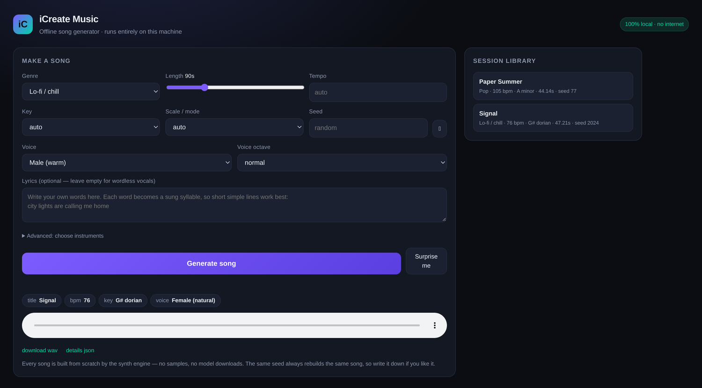
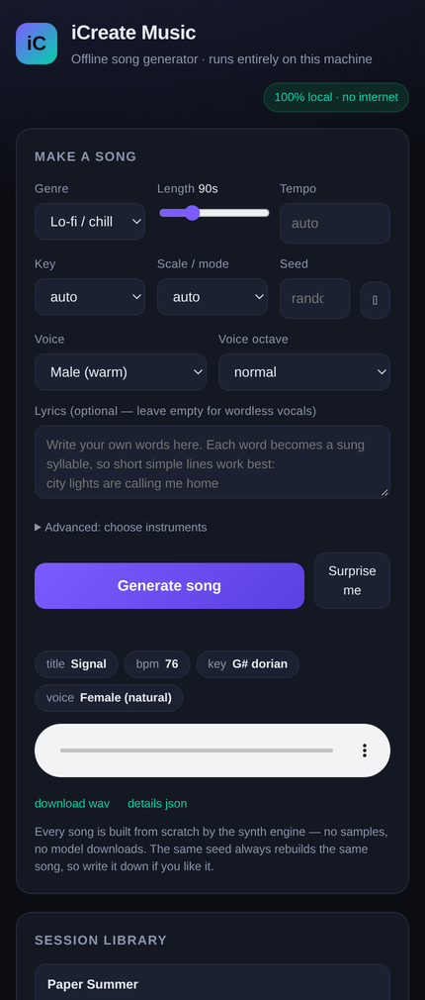

# iCreate Music

A local, offline song generator. Pick a style, press a button, get a finished
stereo track — with drums, bass, chords, a melody and a singing voice — rendered
on your own machine. No account, no API key, no internet, no downloads.

```
python -m icreate_music
```

That opens the app at `http://127.0.0.1:7860`. Press **Generate song**.



<p align="center"></p>

---

## Download the Android app

[**icreate-music.apk**](https://github.com/technicalnihilist-lgtm/icreateappmusic/releases/latest/download/icreate-music.apk)
— 49.5 MB, Android 8.0+, rebuilt automatically on every push to `main`.

It bundles CPython 3.11 + numpy + this engine inside the APK, so the phone
renders songs on-device with no server and no network. Sideload it (enable
"install unknown apps" for your file manager), tap Install, open it. First
launch takes 10–30 s while Python unpacks; after that it is quick. It is
debug-signed, which is fine for personal use but not for the Play Store.

## What this actually is (read this first)

There are two very different things people mean by "AI song generator", and it
matters which one you have:

| | What it is | This app |
|---|---|---|
| **A. Algorithmic composition + synthesis** | Code writes the music theory (key, chords, melody, arrangement) and a synth engine renders every sound from scratch | **Yes — this is what you have** |
| **B. Neural network generation** | A trained model (MusicGen, Stable Audio…) predicts audio from learned weights; needs a multi-GB model file | No — see [Going further](#going-further-if-you-want-a-neural-model) |

So: **unlimited songs, instantly, fully offline, yes.** "AI" here means the
composer is an algorithm — motif generation, chord voicing, arrangement and
voice synthesis are all computed, not sampled from a library. Nothing is
downloaded and no samples are shipped; every kick, string and vowel is
synthesised from maths at render time.

What it is *not*: it will not clone a specific real person's voice out of the
box, and it will not produce the "photorealistic" audio a large diffusion model
does. Those need model weights, which are covered at the end.

---

## Install

Only requirement: **Python 3.8+ and numpy**.

```bash
cd icreate_music
pip install numpy          # the only hard dependency
bash run.sh                # macOS / Linux   (or: python -m icreate_music)
run.bat                    # Windows
```

Then open <http://127.0.0.1:7860>. Stop it with `Ctrl+C`.

## Make a song from the terminal

```bash
# one song, 90 seconds of lo-fi
python -m icreate_music cli --genre lofi --seconds 90

# a named, reproducible song with your own lyrics
python -m icreate_music cli --genre pop --key C --scale minor \
    --bpm 110 --voice female --lyrics "hold the light a little longer" \
    --seed 4242 --out my_song.wav

# an entire album: 20 different songs in one go
python -m icreate_music cli --count 20 --genre edm --seconds 120 --out album/

# instrumental, with per-track stems and an mp3
python -m icreate_music cli --genre cinematic --instrumental --stems --mp3

# what can I choose from?
python -m icreate_music cli --list
```

Every song also writes a `.json` beside the `.wav` with its title, tempo, key,
chord progression, section map, instruments and seed. Same seed + same
settings = the same song, always.

## Genres

Lo-fi / chill · Pop · EDM / dance · Synthwave · Rock · Hip-hop / trap ·
Cinematic / score · Ambient · Folk / acoustic · Jazz

Each genre carries its own tempo range, scales, chord progressions, drum
patterns, instrumentation, swing feel, reverb size and mix balance — that is
why a jazz track and an EDM track sound like different worlds rather than the
same thing at two speeds.

## Voices

Nine voices, all synthesised (a glottal source shaped by vowel formants, with
vibrato, jitter and breath):

`male` · `male_deep` · `female` · `female_high` · `child` · `choir` ·
`breathy` · `robot` · `whisper`

* **Wordless vocals:** leave the lyrics box empty and the singer vocalises.
* **Your own lyrics:** type words and they are sung. The singer splits your text
  into syllables, sings each syllable on one melody note, and picks the vowel
  from the spelling. Simple, vowel-rich lines work best —
  `city lights are calling me home` sings well; dense consonant clusters less so.
* **Register:** the *voice octave* control moves the whole vocal line up or down
  an octave.

Honest limits: this is formant synthesis, so it sounds like a synthetic singer
(think early vocaloid / vocoder-adjacent), not a recorded human. Intelligibility
is approximate — it reads as a voice singing words rather than a studio vocal.

## Instruments

`piano` · `epiano` · `guitar` · `pluck` · `pad` · `strings` · `brass` · `lead` ·
`organ` · `bass` · `sub` · `bell` · `marimba` · `flute`

Assign any of them to the keys, pad, bass, arp or lead slot (CLI:
`--keys-inst organ --bass-inst sub --lead-inst flute`, or the *Advanced* panel
in the app). Drums are built per genre from kick / snare / rim / hat / open hat /
clap / toms / crash / shaker.

## How a song is built

1. **Key and tempo** — chosen from the genre's range, or fixed by you.
2. **Harmony** — a roman-numeral progression from the genre's pool, voiced into
   triads across two octaves.
3. **Melody** — a two-bar motif, repeated and varied, walking through the scale
   with mean reversion so phrases arch instead of drifting, snapping to chord
   tones on strong beats.
4. **Arrangement** — intro / verse / chorus / bridge / outro with an energy
   value per section that decides which instruments enter, how dense the melody
   is, and how hard the drums hit.
5. **Voices** — each instrument renders every note from oscillators, filters and
   envelopes; the singer renders the melody line against your syllables.
6. **Mix** — per-track loudness matching and panning, sidechain pump (EDM),
   convolution reverb built from a synthetic impulse, bus compression, soft
   clipping and a fade.

## The neural lab (optional, `audio-encoders-pytorch`)

`icreate_music/neural.py` uses
[audio-encoders-pytorch](https://github.com/archinetai/audio-encoders-pytorch)
and audio-data-pytorch to train a small neural **audio codec** on your own
generated library, then store songs as compact latents and rebuild them.

```bash
pip install torch torchaudio audio-encoders-pytorch audio-data-pytorch pyloudnorm
python -m icreate_music.neural check
python -m icreate_music.neural train songs/ --steps 2000 --out codec.pt
python -m icreate_music.neural compress songs/mysong.wav --codec codec.pt
python -m icreate_music.neural expand songs/mysong.icm.npz
```

**What it does not do:** it does not generate music. audio-encoders-pytorch
ships encoder/decoder *architectures* and **no pretrained weights** — it is a
library for building and training codecs, not a music model. Training one
locally is genuinely useful for compression and for producing latent tensors a
generative model could later be trained on.

**Measured on this machine** (CPU, 0.12M-param model, 300 steps on one song):
spectral correlation 0.73, waveform correlation 0.06 — it learns the spectral
envelope quickly but not waveform phase. Expect to need thousands of steps (and
ideally a GPU) before a rebuild sounds like the original. The tool reports both
numbers honestly rather than pretending.

## Going further: if you want a neural model

If what you want is a model that *predicts* audio, the practical offline route
is MusicGen — download the weights once, then it runs with no internet:

```bash
pip install torch transformers scipy accelerate
python - <<'PY'
from transformers import AutoProcessor, MusicgenForConditionalGeneration
import scipy.io.wavfile
model_id = "facebook/musicgen-small"          # ~2 GB, fetched once
proc = AutoProcessor.from_pretrained(model_id)
model = MusicgenForConditionalGeneration.from_pretrained(model_id)
inputs = proc(text=["warm lo-fi hip hop with soft piano and vinyl crackle"],
              return_tensors="pt")
audio = model.generate(**inputs, max_new_tokens=512)   # ~10 s of audio
scipy.io.wavfile.write("musicgen.wav", 32000, audio[0, 0].numpy())
PY
```

Reality check: `musicgen-small` on CPU takes minutes per 10 seconds of audio and
gives you no vocals and no lyric control. That is why this app exists — it makes
a full song with a singing voice in seconds on a laptop.

For **voice cloning** of a real person (RVC, So-VITS-SVC, XTTS), you need model
weights and a reference recording, and you should only do it with that person's
consent — cloning someone's voice without permission is illegal in many places
(including under India's IT Rules and personality rights) and is a good way to
lose a friend.

## Android app (APK)

The same engine ships as an Android app — Chaquopy bundles Python 3.11 + numpy
inside the APK, so the phone renders songs on-device with no server and no
network. See [`mobile/README.md`](mobile/README.md) for the build steps.

The quickest route is CI: the **Build APK** workflow compiles
`mobile/` on GitHub's runners and uploads `icreate-music.apk` as an artifact —
no Android Studio needed. Expect slower renders than desktop (2–4×), so keep
phone songs around 30–60 seconds.

## Troubleshooting

**`ImportError: libtorch_cpu.so: failed to map segment`** — the shell has an
address-space cap. Run `ulimit -v unlimited` before starting Python (only
affects the neural lab; the generator never needs torch).

**Rendering feels slow** — a 3-minute song takes roughly 40–60 s on a modern
laptop (about 0.3–0.5× real time). Use `--seconds 60` while experimenting, and
`--sr 22050` for quick sketches.

**No mp3, only wav** — mp3 export needs the `ffmpeg` binary on your PATH;
without it you still get wav. (`brew install ffmpeg` / `sudo apt install ffmpeg`)

**Port already in use** — `python -m icreate_music --port 7861`.

**It sounds nothing like the genre I picked** — try a different seed first
(`--seed`); each genre has a wide expressive range by design.

## Files

```
icreate_music/
├── __main__.py     entry point (web app, or `cli` subcommand)
├── cli.py          command line
├── webapp.py       local web UI (stdlib http.server, no framework)
├── song.py         composer + arranger + mixer, genre definitions
├── theory.py       scales, chords, progressions, titles
├── synth.py        oscillators, instruments, drums, effects
├── voice.py        formant singing synthesis, lyric syllabifier
├── neural.py       optional audio-encoders-pytorch codec lab
└── export.py       wav / stems / manifest writing
```

Everything you make is yours to use. The code is MIT-style: no attribution
needed, no strings attached.
