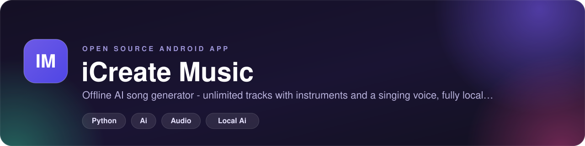

<div align="center">



<a href="https://github.com/technicalnihilist-lgtm/icreateappmusic/stargazers"></a>&nbsp;<a href="https://github.com/technicalnihilist-lgtm/icreateappmusic/network/members"></a>

<a href="https://github.com/technicalnihilist-lgtm/icreateappmusic/releases/latest/download/icreate-music.apk"></a> <a href="https://technicalnihilist-lgtm.github.io/apps-site/apps/icreateappmusic.html"></a>

<b>Support the work</b>

  

<sub>Donations aren't live yet — Paytm, UPI, PayPal and Buy&nbsp;Me&nbsp;a&nbsp;Coffee all show <b>coming soon</b>. Until then, a ⭐ star is the best support.</sub>

</div>

---

## Download the Android app

[**icreate-music.apk**](https://github.com/technicalnihilist-lgtm/icreateappmusic/releases/latest/download/icreate-music.apk)
— 49.5 MB, Android 8.0+, rebuilt automatically on every push to `main`.

It bundles CPython 3.11 + numpy + this engine inside the APK, so the phone
renders songs on-device with no server and no network. Sideload it (enable
"install unknown apps" for your file manager), tap Install, open it. First
launch takes 10–30 s while Python unpacks; after that it is quick. It is
debug-signed, which is fine for personal use but not for the Play Store.

## What this actually is (read this first)

There are two very different things people mean by "AI song generator", and it
matters which one you have:

| | What it is | This app |
|---|---|---|
| **A. Algorithmic composition + synthesis** | Code writes the music theory (key, chords, melody, arrangement) and a synth engine renders every sound from scratch | **Yes — this is what you have** |
| **B. Neural network generation** | A trained model (MusicGen, Stable Audio…) predicts audio from learned weights; needs a multi-GB model file | No — see [Going further](#going-further-if-you-want-a-neural-model) |

So: **unlimited songs, instantly, fully offline, yes.** "AI" here means the
composer is an algorithm — motif generation, chord voicing, arrangement and
voice synthesis are all computed, not sampled from a library. Nothing is
downloaded and no samples are shipped; every kick, string and vowel is
synthesised from maths at render time.

What it is *not*: it will not clone a specific real person's voice out of the
box, and it will not produce the "photorealistic" audio a large diffusion model
does. Those need model weights, which are covered at the end.

---

## Install

Only requirement: **Python 3.8+ and numpy**.

```bash
cd icreate_music
pip install numpy          # the only hard dependency
bash run.sh                # macOS / Linux   (or: python -m icreate_music)
run.bat                    # Windows
```

Then open <http://127.0.0.1:7860>. Stop it with `Ctrl+C`.

## Make a song from the terminal

```bash
## Genres

Lo-fi / chill · Pop · EDM / dance · Synthwave · Rock · Hip-hop / trap ·
Cinematic / score · Ambient · Folk / acoustic · Jazz

Each genre carries its own tempo range, scales, chord progressions, drum
patterns, instrumentation, swing feel, reverb size and mix balance — that is
why a jazz track and an EDM track sound like different worlds rather than the
same thing at two speeds.

## Voices

Nine voices, all synthesised (a glottal source shaped by vowel formants, with
vibrato, jitter and breath):

`male` · `male_deep` · `female` · `female_high` · `child` · `choir` ·
`breathy` · `robot` · `whisper`

* **Wordless vocals:** leave the lyrics box empty and the singer vocalises.
* **Your own lyrics:** type words and they are sung. The singer splits your text
  into syllables, sings each syllable on one melody note, and picks the vowel
  from the spelling. Simple, vowel-rich lines work best —
  `city lights are calling me home` sings well; dense consonant clusters less so.
* **Register:** the *voice octave* control moves the whole vocal line up or down
  an octave.

Honest limits: this is formant synthesis, so it sounds like a synthetic singer
(think early vocaloid / vocoder-adjacent), not a recorded human. Intelligibility
is approximate — it reads as a voice singing words rather than a studio vocal.

## Train a voice from a song

Put in any song — an artist's track, your own recording — and the app will
split it, study the singer, and add that voice to the list you can generate
with. All local.

```bash
## Instruments

`piano` · `epiano` · `guitar` · `pluck` · `pad` · `strings` · `brass` · `lead` ·
`organ` · `bass` · `sub` · `bell` · `marimba` · `flute`

Assign any of them to the keys, pad, bass, arp or lead slot (CLI:
`--keys-inst organ --bass-inst sub --lead-inst flute`, or the *Advanced* panel
in the app). Drums are built per genre from kick / snare / rim / hat / open hat /
clap / toms / crash / shaker.

## How a song is built

1. **Key and tempo** — chosen from the genre's range, or fixed by you.
2. **Harmony** — a roman-numeral progression from the genre's pool, voiced into
   triads across two octaves.
3. **Melody** — a two-bar motif, repeated and varied, walking through the scale
   with mean reversion so phrases arch instead of drifting, snapping to chord
   tones on strong beats.
4. **Arrangement** — intro / verse / chorus / bridge / outro with an energy
   value per section that decides which instruments enter, how dense the melody
   is, and how hard the drums hit.
5. **Voices** — each instrument renders every note from oscillators, filters and
   envelopes; the singer renders the melody line against your syllables.
6. **Mix** — per-track loudness matching and panning, sidechain pump (EDM),
   convolution reverb built from a synthetic impulse, bus compression, soft
   clipping and a fade.

## The neural lab (optional, `audio-encoders-pytorch`)

`icreate_music/neural.py` uses
[audio-encoders-pytorch](https://github.com/archinetai/audio-encoders-pytorch)
and audio-data-pytorch to train a small neural **audio codec** on your own
generated library, then store songs as compact latents and rebuild them.

```bash
pip install torch torchaudio audio-encoders-pytorch audio-data-pytorch pyloudnorm
python -m icreate_music.neural check
python -m icreate_music.neural train songs/ --steps 2000 --out codec.pt
python -m icreate_music.neural compress songs/mysong.wav --codec codec.pt
python -m icreate_music.neural expand songs/mysong.icm.npz
```

**What it does not do:** it does not generate music. audio-encoders-pytorch
ships encoder/decoder *architectures* and **no pretrained weights** — it is a
library for building and training codecs, not a music model. Training one
locally is genuinely useful for compression and for producing latent tensors a
generative model could later be trained on.

**Measured on this machine** (CPU, 0.12M-param model, 300 steps on one song):
spectral correlation 0.73, waveform correlation 0.06 — it learns the spectral
envelope quickly but not waveform phase. Expect to need thousands of steps (and
ideally a GPU) before a rebuild sounds like the original. The tool reports both
numbers honestly rather than pretending.

## Going further: if you want a neural model

If what you want is a model that *predicts* audio, the practical offline route
is MusicGen — download the weights once, then it runs with no internet:

```bash
pip install torch transformers scipy accelerate
python - <<'PY'
from transformers import AutoProcessor, MusicgenForConditionalGeneration
import scipy.io.wavfile
model_id = "facebook/musicgen-small"          # ~2 GB, fetched once
proc = AutoProcessor.from_pretrained(model_id)
model = MusicgenForConditionalGeneration.from_pretrained(model_id)
inputs = proc(text=["warm lo-fi hip hop with soft piano and vinyl crackle"],
              return_tensors="pt")
audio = model.generate(**inputs, max_new_tokens=512)   # ~10 s of audio
scipy.io.wavfile.write("musicgen.wav", 32000, audio[0, 0].numpy())
PY
```

Reality check: `musicgen-small` on CPU takes minutes per 10 seconds of audio and
gives you no vocals and no lyric control. That is why this app exists — it makes
a full song with a singing voice in seconds on a laptop.

For **voice cloning** of a real person (RVC, So-VITS-SVC, XTTS), you need model
weights and a reference recording, and you should only do it with that person's
consent — cloning someone's voice without permission is illegal in many places
(including under India's IT Rules and personality rights) and is a good way to
lose a friend.

## Android app (APK)

The same engine ships as an Android app — Chaquopy bundles Python 3.11 + numpy
inside the APK, so the phone renders songs on-device with no server and no
network. See [`mobile/README.md`](mobile/README.md) for the build steps.

The quickest route is CI: the **Build APK** workflow compiles
`mobile/` on GitHub's runners and uploads `icreate-music.apk` as an artifact —
no Android Studio needed. Expect slower renders than desktop (2–4×), so keep
phone songs around 30–60 seconds.

## Troubleshooting

**`ImportError: libtorch_cpu.so: failed to map segment`** — the shell has an
address-space cap. Run `ulimit -v unlimited` before starting Python (only
affects the neural lab; the generator never needs torch).

**Rendering feels slow** — a 3-minute song takes roughly 40–60 s on a modern
laptop (about 0.3–0.5× real time). Use `--seconds 60` while experimenting, and
`--sr 22050` for quick sketches.

**No mp3, only wav** — mp3 export needs the `ffmpeg` binary on your PATH;
without it you still get wav. (`brew install ffmpeg` / `sudo apt install ffmpeg`)

**Port already in use** — `python -m icreate_music --port 7861`.

**It sounds nothing like the genre I picked** — try a different seed first
(`--seed`); each genre has a wide expressive range by design.

## Files

```
icreate_music/
├── __main__.py     entry point (web app, or `cli` subcommand)
├── cli.py          command line
├── webapp.py       local web UI (stdlib http.server, no framework)
├── song.py         composer + arranger + mixer, genre definitions
├── theory.py       scales, chords, progressions, titles
├── synth.py        oscillators, instruments, drums, effects
├── voice.py        formant singing synthesis, lyric syllabifier
├── neural.py       optional audio-encoders-pytorch codec lab
└── export.py       wav / stems / manifest writing
```

Everything you make is yours to use. The code is MIT-style: no attribution
needed, no strings attached.

---

---

## 🌍 Languages

<sub>Donations are <b>coming soon</b> in every language below — nothing to pay today, nothing to click.</sub>

<div align="center">

<sub><b>हिन्दी · বাংলা · मराठी · తెలుగు · தமிழ் · ગુજરાતી · ಕನ್ನಡ · മലയാളം · ਪੰਜਾਬੀ · ଓଡ଼ିଆ · অসমীয়া · اردو</b></sub>

</div>

<details>
<summary><b>🌍 Open the same message in 53 languages</b></summary>

**🇮🇳 Indian languages**

- **हिन्दी** (Hindi) — ☕ जल्द ही आ रहा है। · ⭐ अगर आपको यह ऐप और हमारा काम पसंद है, तो कृपया रिपॉजिटरी को स्टार दें और हमें फॉलो करें।
- **বাংলা** (Bengali) — ☕ খুব শিগগিরই আসছে। · ⭐ যদি আপনার এই অ্যাপ এবং আমাদের কাজ ভালো লাগে, তবে অনুগ্রহ করে রিপোজিটরিটিকে একটি স্টার দিন এবং আমাদের ফলো করুন।
- **मराठी** (Marathi) — ☕ लवकरच येत आहे. · ⭐ जर तुम्हाला हे ॲप आणि आमचं काम आवडलं असेल, तर कृपया रिपॉझिटरीला स्टार द्या आणि आम्हाला फॉलो करा.
- **తెలుగు** (Telugu) — ☕ త్వరలో రాబోతోంది. · ⭐ మీకు ఈ యాప్, మా పని నచ్చితే, దయచేసి రిపోజిటరీకి ఒక స్టార్ ఇచ్చి మమ్మల్ని ఫాలో అవ్వండి.
- **தமிழ்** (Tamil) — ☕ விரைவில் வருகிறது. · ⭐ உங்களுக்கு இந்த ஆப்பும் எங்க வேலையும் பிடிச்சிருந்தா, தயவுசெஞ்சு இந்த ரெபாசிட்டரிக்கு ஒரு ஸ்டார்…
- **ગુજરાતી** (Gujarati) — ☕ ટૂંક સમયમાં આવી રહ્યું છે. · ⭐ જો તમને આ એપ અને અમારું કામ ગમતું હોય, તો પ્લીઝ રિપોઝિટરીને સ્ટાર આપો અને અમને ફોલો કરો.
- **ಕನ್ನಡ** (Kannada) — ☕ ಶೀಘ್ರದಲ್ಲೇ ಬರುತ್ತಿದೆ. · ⭐ ನಿಮಗೆ ಈ ಆ್ಯಪ್ ಮತ್ತು ನಮ್ಮ ಕೆಲಸ ಇಷ್ಟವಾದರೆ, ದಯವಿಟ್ಟು ರೆಪೊಸಿಟರಿಗೆ ಸ್ಟಾರ್ ಕೊಡಿ ಮತ್ತು ನಮ್ಮನ್ನು ಫಾಲೋ ಮಾಡಿ.
- **മലയാളം** (Malayalam) — ☕ ഉടൻ വരുന്നു. · ⭐ നിങ്ങൾക്ക് ഈ ആപ്പും ഞങ്ങളുടെ പ്രവർത്തനവും ഇഷ്ടപ്പെട്ടെങ്കിൽ, ദയവായി റെപ്പോസിറ്ററിക്ക് ഒരു സ്റ്റാർ…
- **ਪੰਜਾਬੀ** (Punjabi) — ☕ ਜਲਦੀ ਆ ਰਿਹਾ ਹੈ। · ⭐ ਜੇ ਤੁਹਾਨੂੰ ਇਹ ਐਪ ਅਤੇ ਸਾਡਾ ਕੰਮ ਪਸੰਦ ਹੈ, ਤਾਂ ਕਿਰਪਾ ਕਰਕੇ ਰਿਪੋਜ਼ਟਰੀ ਨੂੰ ਸਟਾਰ ਦਿਓ ਅਤੇ ਸਾਨੂੰ ਫਾਲੋ ਕਰੋ।
- **ଓଡ଼ିଆ** (Odia) — ☕ ଖୁବ୍ ଶୀଘ୍ର ଆସୁଛି। · ⭐ ଯଦି ଆପଣଙ୍କୁ ଏହି ଆପ୍ ଏବଂ ଆମର କାମ ଭଲ ଲାଗୁଛି, ତେବେ ଦୟାକରି ରିପୋଜିଟୋରୀକୁ ଗୋଟିଏ ଷ୍ଟାର୍ ଦିଅନ୍ତୁ ଏବଂ ଆମକୁ ଫଲୋ କରନ୍ତୁ।
- **অসমীয়া** (Assamese) — ☕ অতি সোনকালেই আহি আছে। · ⭐ যদি আপুনি এই এপটো আৰু আমাৰ কাম ভাল পায়, তেন্তে অনুগ্ৰহ কৰি ৰিপজিটৰীটোক এটা ষ্টাৰ দিয়ক আৰু আমাক ফ'ল' কৰক।
- **اردو** (Urdu) — ☕ جلد آرہا ہے۔ · ⭐ اگر آپ کو یہ ایپ اور ہمارا کام پسند آئے تو براہ کرم ریپازٹری کو سٹار دیں اور ہمیں فالو کریں۔
- **संस्कृतम्** (Sanskrit) — ☕ शीघ्रमेव आगच्छति।
- **मैथिली** (Maithili) — ☕ जल्दिये आबि रहल अछि।
- **कोंकणी** (Konkani) — ☕ रोखडेंच येता.
- **کٲشُر** (Kashmiri) — ☕ جَلدی یِوان چھُ۔
- **سنڌي** (Sindhi) — ☕ जल्द अची रह्यो आहे।
- **डोगरी** (Dogri) — ☕ जल्दी आ करदा ऐ।
- **ꯃꯤꯇꯩ ꯂꯣꯟ** (Manipuri) — ☕ ꯑꯊꯨꯕꯥ ꯃꯇꯝꯗꯥ ꯂꯥꯛꯀꯅꯤ꯫
- **बर’** (Bodo) — ☕ थाबैनो फैगोन।
- **ᱥᱟᱱᱛᱟᱲᱤ** (Santali) — ☕ ᱞᱚᱜᱚᱱ ᱦᱤᱡᱩᱜ ᱠᱟᱱᱟ᱾
- **नेपाली** (Nepali) — ☕ छिट्टै आउँदैछ। · ⭐ यदि तपाईंलाई यो एप र हाम्रो काम मन पर्‍यो भने, कृपया रिपोजिटरीलाई स्टार दिनुहोस् र हामीलाई फलो गर्नुहोस्।

**🌍 World languages**

- **العربية** (Arabic) — ☕ قريبًا. · ⭐ إذا أعجبك هذا التطبيق وعملنا، فيرجى منح المستودع نجمة ومتابعتنا.
- **简体中文** (Chinese (Simplified)) — ☕ 即将推出。
- **繁體中文** (Chinese (Traditional)) — ☕ 即將推出。
- **Čeština** (Czech) — ☕ Již brzy.
- **Dansk** (Danish) — ☕ Kommer snart.
- **Nederlands** (Dutch) — ☕ Binnenkort beschikbaar. · ⭐ Vind je deze app en ons werk leuk?
- **Filipino** (Filipino) — ☕ Malapit na.
- **Suomi** (Finnish) — ☕ Tulossa pian.
- **Français** (French) — ☕ Bientôt disponible. · ⭐ Si cette application et notre travail vous plaisent, mettez une étoile au dépôt et suivez-nous.
- **Deutsch** (German) — ☕ Bald verfügbar. · ⭐ Wenn dir diese App und unsere Arbeit gefallen, gib dem Repository einen Stern und folge uns.
- **Ελληνικά** (Greek) — ☕ Έρχεται σύντομα.
- **עברית** (Hebrew) — ☕ בקרוב.
- **Magyar** (Hungarian) — ☕ Hamarosan.
- **Bahasa Indonesia** (Indonesian) — ☕ Segera hadir. · ⭐ Jika kamu suka aplikasi ini dan karya kami, beri bintang pada repositori ini dan ikuti kami.
- **Italiano** (Italian) — ☕ In arrivo.
- **日本語** (Japanese) — ☕ 近日公開。 · ⭐ このアプリと私たちの仕事が気に入ったら、リポジトリにスターを付けてフォローしてください。
- **한국어** (Korean) — ☕ 곧 공개됩니다. · ⭐ 이 앱과 저희 작업이 마음에 드신다면 저장소에 스타를 눌러 주시고 팔로우해 주세요.
- **Bahasa Melayu** (Malay) — ☕ Akan datang.
- **Norsk** (Norwegian) — ☕ Kommer snart.
- **فارسی** (Persian) — ☕ به‌زودی.
- **Polski** (Polish) — ☕ Wkrótce. · ⭐ Jeśli podoba Ci się ta aplikacja i nasza praca, daj repozytorium gwiazdkę i obserwuj nas.
- **Português** (Portuguese) — ☕ Em breve.
- **Română** (Romanian) — ☕ În curând.
- **Русский** (Russian) — ☕ Скоро. · ⭐ Если вам нравится это приложение и наша работа, поставьте звёздочку репозиторию и подпишитесь на нас.
- **Español** (Spanish) — ☕ Muy pronto. · ⭐ Si te gusta esta app y nuestro trabajo, dale una estrella al repositorio y síguenos.
- **Kiswahili** (Swahili) — ☕ Inakuja hivi karibuni.
- **Svenska** (Swedish) — ☕ Kommer snart.
- **ไทย** (Thai) — ☕ เร็ว ๆ นี้
- **Türkçe** (Turkish) — ☕ Çok yakında.
- **Українська** (Ukrainian) — ☕ Незабаром.
- **Tiếng Việt** (Vietnamese) — ☕ Sắp ra mắt. · ⭐ Nếu bạn thích ứng dụng này và công việc của chúng tôi, hãy tặng kho lưu trữ một ngôi sao và theo…

</details>

